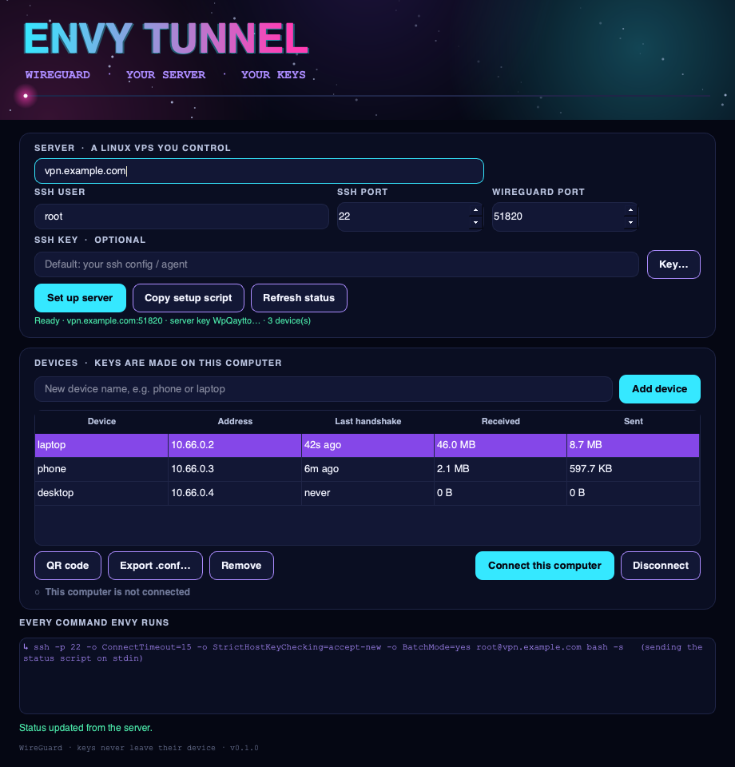

<p align="center"><b>ENVY TUNNEL</b><br />Your own WireGuard VPN, on a server you control.</p>

<p align="center">
  <a href="https://github.com/xzchick/envy-tunnel/actions/workflows/tests.yml"></a>
</p>
<p align="center">
  
  
  <br />
  
  
  
</p>
<p align="center">
  <a href="https://github.com/xzchick/envy-tunnel/releases/latest"></a>
  <a href="#verifying-a-release"></a>
  <a href="https://github.com/xzchick/envy-tunnel/releases/latest"></a>
  <a href="#install-on-linux"></a>
  <a href="https://xzchick.github.io/homebrew-envy/"></a>
</p>

ENVY Tunnel turns a cheap Linux VPS that **you** rent into a private VPN for your laptop,
desktop and phone. It sets up standard [WireGuard](https://www.wireguard.com/) on the server
over your own SSH, makes each device's keys on that device, and gives you a config file or a QR
code for the official WireGuard apps. There's no ENVY account, no ENVY server and no
subscription: the only VPN provider involved is you.

<p align="center"></p>

## How it works

```text
 your laptop / phone  ──WireGuard (UDP 51820)──▶  your VPS  ──NAT──▶  the internet
   keys made here                                 key made there
```

1. **Set up the server.** ENVY runs one readable, idempotent bash script over `ssh`: it
   installs `wireguard-tools`, generates the server key *on the server*, creates `wg0` with
   NAT and IP forwarding, opens the UDP port in ufw/firewalld if they're on, and starts it
   with systemd (so it comes back after a reboot). It refuses to touch a `wg0` it didn't create.
2. **Add devices.** Each device gets its own key pair and a preshared key, made on this
   computer. Only the *public* key and preshared key go to the server; it's applied live
   (`wg syncconf`), so devices already connected stay connected.
3. **Connect.** Scan the QR code with the WireGuard app on iOS/Android, import the `.conf`
   anywhere, or click **Connect this computer**.
4. **Revoke** a device and it's cut off immediately.

All traffic goes through the tunnel by default, IPv4 and IPv6 (so IPv6 can't leak around it).
`--split` makes a config that only reaches the tunnel's own addresses.

## Using it

The app window does everything below. The same is available from a terminal:

```sh
envy-tunnel init --host vpn.example.com --user root   # or a sudo user; key auth via your ssh setup
envy-tunnel setup                                      # install + start WireGuard on the server
envy-tunnel add phone --qr                             # new device; scan the QR with the WireGuard app
envy-tunnel add laptop
envy-tunnel up laptop                                  # connect this computer
envy-tunnel status                                     # last handshake + traffic per device
envy-tunnel remove phone                               # revoke
envy-tunnel down
```

No SSH access from this machine? `envy-tunnel setup --print` prints the script; paste it into
your provider's web console as root, then `envy-tunnel set-server-key <key it printed>`.

### Connecting this computer

ENVY hands the config to the WireGuard implementation your OS already trusts; it doesn't ship
its own VPN driver.

| OS | Uses | Notes |
|---|---|---|
| **Linux** | NetworkManager (`nmcli`), or `wg-quick` | NetworkManager needs no root; `wg-quick` asks via `sudo`/`pkexec` |
| **macOS** | `wg-quick` from `brew install wireguard-tools` | or import the exported `.conf` into the official WireGuard app |
| **Windows** | [WireGuard for Windows](https://www.wireguard.com/install/) tunnel service | asks for administrator approval (UAC) |
| **iOS / Android** | the official WireGuard app | scan the QR code |

### What you need

- A Linux VPS with a public IP and a KVM-type virtualisation (most providers; some OpenVZ/LXC
  plans lack the WireGuard kernel module — the setup script tells you). Debian, Ubuntu, Fedora,
  RHEL-family, Arch, openSUSE and Alpine package managers are supported.
- SSH access as root, or as a user with passwordless sudo (the default on most cloud images).
- UDP 51820 (or the port you pick) allowed in your **provider's** firewall/security group, if it has one.

## Install

**macOS (Homebrew, Apple Silicon)**

```sh
brew tap xzchick/envy https://github.com/xzchick/homebrew-envy
brew install --cask envy-tunnel
```

**Windows**: download `envy-tunnel-vX.Y.Z-windows-x86_64.zip` from the
[latest release](https://github.com/xzchick/envy-tunnel/releases/latest), unzip, and run
`envy-tunnel.exe`. The `ssh` it uses is Windows' built-in OpenSSH Client.

## Install on Linux

One command (downloads the latest release bundle, verifies it against the signed
`SHA256SUMS`, and installs under `~/.local` with a desktop entry, no root needed):

```sh
curl -fsSL https://raw.githubusercontent.com/xzchick/envy-tunnel/main/install.sh | sh
```

Prefer to inspect first? Download `install.sh`, read it, then run `sh install.sh`.

**From source** (any OS, Python 3.10+): `pip install .` then `envy-tunnel`.

## Verifying a release

Every release's `SHA256SUMS.txt` is signed with Sigstore (keyless) and ships with a CycloneDX SBOM:

```sh
cosign verify-blob \
  --bundle SHA256SUMS.txt.sigstore.json \
  --certificate-identity-regexp 'https://github.com/xzchick/envy-tunnel/.github/workflows/release.yml@.*' \
  --certificate-oidc-issuer https://token.actions.githubusercontent.com \
  SHA256SUMS.txt
sha256sum --check --ignore-missing SHA256SUMS.txt
```

## Tested for real

Besides unit tests on macOS, Windows and Linux, every push runs an **end-to-end WireGuard
test** on a throwaway Linux VM: ENVY's actual setup script builds the server, a network
namespace connects as a client with the config ENVY generated, and CI checks the handshake,
traffic through the tunnel, NAT out to the internet, live add/revoke, that a revoked device is
cut off, and a clean uninstall (`scripts/e2e_wireguard.py`).

## Security and privacy

- **Keys stay where they're made.** Device private keys are generated on this computer and are
  never sent to the server; the server's private key is generated on the server and never leaves it.
- **Stored locally, owner-only.** Device keys live in `secrets.json` in ENVY's data folder
  (`0600` on macOS/Linux; your per-user profile on Windows). Exported `.conf` files and QR codes
  contain a private key: import them, then delete them. Files are never overwritten.
- **No passwords.** ENVY uses your own `ssh` with keys or an agent; it never asks for or stores
  a server password.
- **Nothing hidden.** Every command ENVY runs is shown (the app's log, or stderr in the terminal),
  and every server script can be printed and read before it runs.
- **A VPN moves trust, it doesn't remove it.** Your VPS provider can see the traffic leaving your
  server, the same way your ISP could before. ENVY Tunnel is for privacy on untrusted networks and
  controlling your own exit point — not anonymity.

## Roadmap

New in the suite; ideas and bug reports are welcome in [Issues](https://github.com/xzchick/envy-tunnel/issues).

MIT licensed. Part of [ENVY BLACK VEIL](https://xzchick.github.io/homebrew-envy/).
